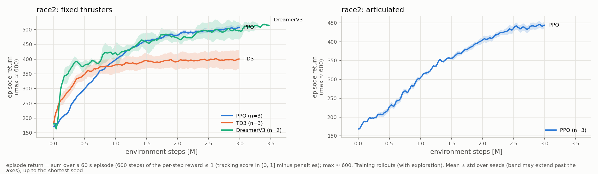
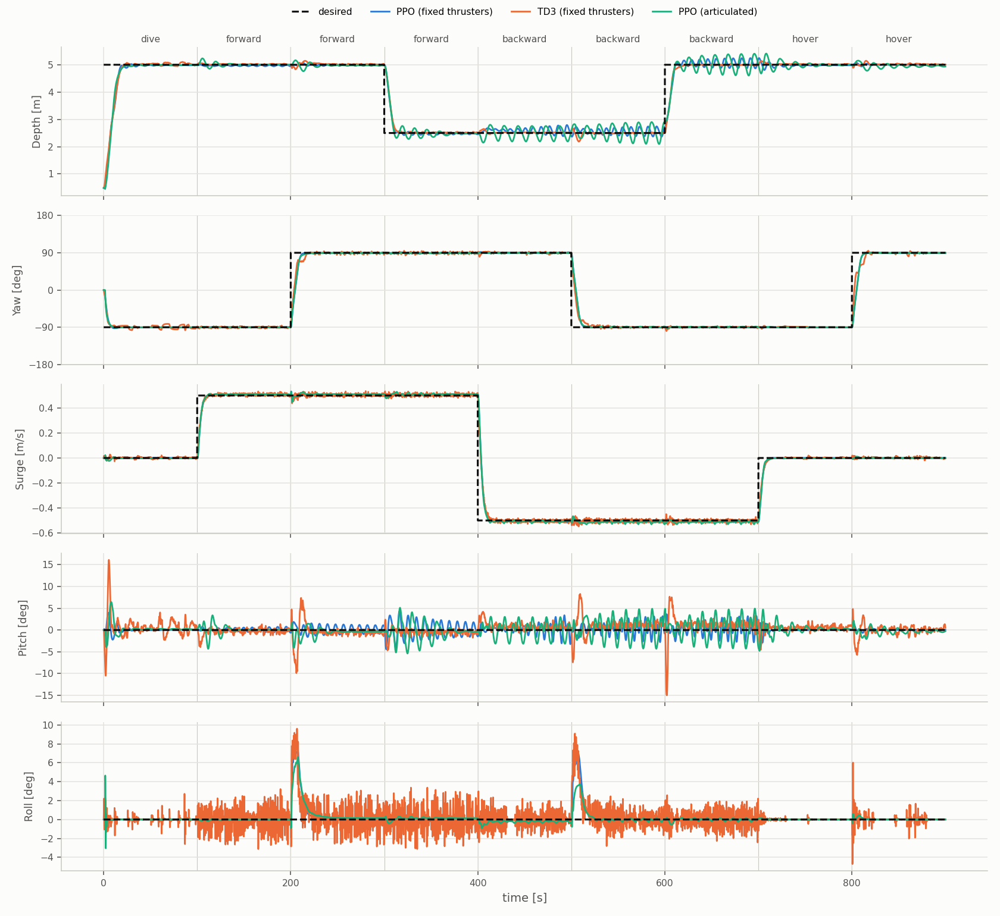
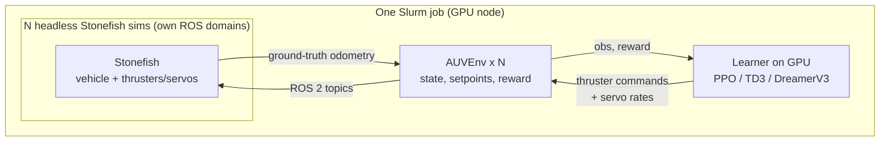

# AUV RL Control

End-to-end deep reinforcement learning controllers for autonomous underwater vehicles, trained in the
[Stonefish](https://github.com/patrykcieslak/stonefish) simulator with ROS 2 Jazzy. The policy maps the vehicle state and
tracking errors directly to thruster commands (and, for articulated thrusters, servo angle rates), replacing the
thrust-allocation QP + PID of the model-based controller ([mvp_control](https://github.com/GSO-soslab/mvp_control), [Our IROS 2025 paper](https://ieeexplore.ieee.org/abstract/document/11246645)),
which is kept as the baseline.

- **Vehicles** (`sb3/vehicles.py`, selected with `RACE2_VEHICLE`):
  - `race2`: 4 thrusters + 2 articulated (servo-tilted) surge thrusters, run fixed or articulated
  - `race_auv`: 6 fixed thrusters ([GSO-soslab/race_auv](https://github.com/GSO-soslab/race_auv), branch `jazzy-devel-perception`)
- **Algorithms**: PPO and TD3 (Stable-Baselines3), DreamerV3 ([dreamerv3-torch](https://github.com/NM512/dreamerv3-torch) port, MLP/GRU only)
- **Task**: depth, surge, yaw, pitch and roll tracking with random step setpoints; roll and pitch targets up to ±90°
  (rotation-based attitude error, no Euler singularity)

## Plots





## How it works



The race_auv thruster topics are the real vehicle's driver topics, so a trained policy publishes to the same topics on
hardware (sim-to-real transfer is future work). The QP + PID controller is only the baseline it is compared against.

## Repository layout

| Path | Contents |
|---|---|
| `sb3/AUVEnv.py` | Gymnasium env over a running Stonefish sim (ROS 2): observation, reward, termination, respawn |
| `sb3/vehicles.py` | Per-vehicle definition: namespace, thrusters (action order), servos, IMU topic, frame offsets |
| `sb3/ppo_sb3.py`, `td3_sb3.py`, `dreamer_train.py` | Trainers (one learner on N parallel sims) |
| `sb3/config/` | `config_sac.yaml`: env + reward (shared by all algorithms); `config_{ppo,td3,dreamer}.yaml`: hyperparameters |
| `sb3/eval_*.py`, `fig4_protocols.py` | Evaluation: step-response protocols (Fig-4, articulated, att90) and checkpoint evaluation |
| `sb3/plot_*.py`, `summarize_fig4.py`, `select_best_policies.py` | Learning curves, tables, best-policy selection |
| `sb3/live_policy.py`, `joystick_pilot.py` | Run a policy live and pilot it with an on-screen joystick |
| `infra/` | Cluster tooling: `race2.sh` (Apptainer wrapper), Slurm scripts, launch files, Stonefish scene, patches |
| `docs/` | [Reward formulation](docs/reward_formulation.md), [training pipeline](docs/rl_training_pipeline.md), [handoff notes](docs/HANDOFF.md) |

## Setup (AICR cluster)

Everything runs in an Apptainer image with ROS 2 Jazzy, Stonefish and the vehicle packages. `infra/race2.sh` (linked as
`~/ros2_ws/race2.sh`) clones the ROS repos at the pinned branches, builds the image and the colcon workspace:

```bash
ln -s ~/race2_q_learning_control/infra/race2.sh ~/ros2_ws/race2.sh
ln -s ~/race2_q_learning_control/infra/train_vec.sbatch ~/ros2_ws/train_vec.sbatch
~/ros2_ws/race2.sh setup        # clone + build image + colcon build
~/ros2_ws/race2.sh build        # rebuild the workspace after changes
```

## Training

A training job starts N headless Stonefish sims (one per ROS domain, allocated per node by `infra/domain_lock.sh`) and one
learner. Env and reward options are `RACE2_*` environment variables (full list in the
[pipeline doc](docs/rl_training_pipeline.md)); the main ones:

| Variable | Meaning |
|---|---|
| `RACE2_VEHICLE` | `race2` or `race_auv` |
| `RACE2_SERVOS`, `RACE2_ACTION` | `0` = fixed thrusters; `2` + `rate` = articulated, servo angle-rate actions |
| `RACE2_STAGE=3`, `RACE2_SURGE_REWARD=horizon` | All DOFs commanded; surge tracked against a moving virtual target |
| `RACE2_REF_ALL`, `RACE2_INTEGRAL` | Reference model on the setpoints; leaky error integrals in reward and observation |
| `RACE2_PAPER_TERMS`, `RACE2_K_SLEW` | Adaptive effort weight (IROS Eq. 4); servo slew cost |
| `RACE2_ATT_SP`, `RACE2_ROLL_MAX_DEG`, `RACE2_PITCH_MAX_DEG` | Commanded roll/pitch targets and their range |
| `RACE2_ATT_REP=rot` | Rotation-based attitude error (needed for targets near 90°) |

One run:

```bash
RACE2_VEHICLE=race_auv RACE2_SERVOS=0 RACE2_STAGE=3 RACE2_SURGE_REWARD=horizon RACE2_PAPER_TERMS=1 RACE2_DEPTH_INV=1 \
RACE2_ATT_SP=1 RACE2_REF_ALL=1 RACE2_INTEGRAL=1 RACE2_ROLL_MAX_DEG=90 RACE2_PITCH_MAX_DEG=90 RACE2_DEPTH_MAX=12 RACE2_ATT_REP=rot \
TRAINER=ppo STEPS=3000000 EXTRA="--seed 1" \
sbatch -p rtx-batch --cpus-per-task=32 --mem=96G --time=08:00:00 ~/ros2_ws/train_vec.sbatch
```

The full experiment set (PPO/TD3 × 3 seeds per configuration, DreamerV3 10M-step chains, all evaluations queued after
training): `infra/submit_paper_runs.sh [fixed slew rauv]`. DreamerV3 runs longer than the 8 h job limit by resuming across
chained jobs (`--run_id`, `--max_hours`).

Runs are written to `sb3/logs/<algo>_<time>_<settings>_seed-N/` (`progress.csv`, TensorBoard, `final_model`, `run_info/`
with the job's settings and hardware); checkpoints are kept on `/scratch` through a symlink.

## Evaluation and results

```bash
# step-response protocols on every run of the given jobs (Fig-4 at two surge speeds; PROTOCOL=artic|att90 for the others)
JOB_PREFIX=ra_ppo,ra_td3 SURGES="0.15 0.5" sbatch -p rtx-batch --cpus-per-task=32 --mem=96G infra/eval_fig4.sbatch
# deterministic evaluation of the checkpoints (evaluation-return learning curves)
RACE2_VEHICLE=race_auv ... TRAINER=evalckpt SIMS=20 STEPS=0 EXTRA="--runs-from-jobs ra_ppo,ra_td3" sbatch ... ~/ros2_ws/train_vec.sbatch

python3 sb3/plot_training_curves.py --out results/<vehicle>/<date>/training_curves.png --filter <tags>
python3 sb3/plot_eval_curves.py     --out results/<vehicle>/<date>/eval_curves --filter <tags>    # + IQM table with CIs
python3 sb3/summarize_fig4.py --out results/<vehicle>/<date> LABEL='sb3/logs/<glob>' ...
python3 infra/collect_run_stats.py --filter <tags> --out results/<vehicle>/<date>/run_stats      # time and hardware per run
python3 sb3/select_best_policies.py --out results/<vehicle>/<date> --filter <tags>               # one policy per method
```

## Live piloting

From a desktop session (GPU-rendered sim):

```bash
infra/pilot.sh sb3/logs/<run>
```

Mouse pad: surge (up/down) and yaw rate (left/right); keys: W/S surge, A/D yaw, ↑/↓ depth, I/K pitch, J/L roll,
Space stop, R respawn.

## Adding a vehicle

1. Add an entry to `VEHICLES` in `sb3/vehicles.py` (namespace, thrusters in action order, servos, IMU topic,
   whether roll is controllable without servos, ground-truth roll offset).
2. Add its launch to the vehicle `case` in `infra/race2.sh` (and its packages to `REPOS`/`PKGS`).
3. Train with `RACE2_VEHICLE=<name>`; observation and action sizes follow from the entry.

## Legacy code

Earlier experiments are still in the repository but are not part of the current pipeline: SAC with offline CSV training
from rosbags (`sb3/sac_sb3.py`, `rosbag_to_csv.py`, `csv_*.py`, `SAC_offline/`), the DDPG and DQN prototypes (`DDPG/`, `DQN/`),
and offline DreamerV3 from MCAP data (`dreamerv3/`, `sb3/train_dreamerv3_offline.py`, `sb3/AUVEnv_DreamerV3.py`).
