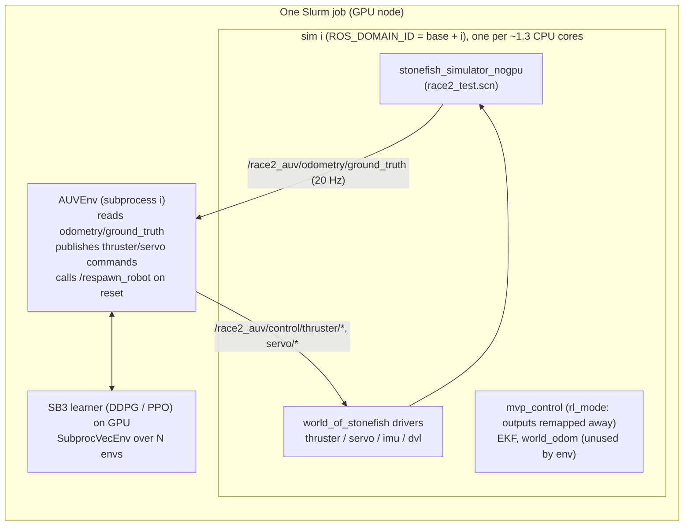

# RACE2 RL training pipeline

Design and operations notes for training RL controllers for the RACE2 AUV in Stonefish on the
AICR cluster. This is the source of truth; update it when you change the env, the reward or
the infrastructure.

Status: **working pipeline, controller not converged yet** (stage-1 curriculum runs in progress,
2026-10-27).

## 1. Architecture



- One **learner** process, on the GPU, drives **N envs** (SB3 `SubprocVecEnv`). Each env is a subprocess
  attached to its own Stonefish instance on its own `ROS_DOMAIN_ID` (discovery `LOCALHOST`). N is limited by CPUs, not GPU.
- Training sims run **without rendering** (`stonefish_simulator_nogpu`). One rendered sim saturates a
  B200's GPU and costs ~1 CPU core; physics and the IMU/DVL/pressure/GPS sensors are identical. Only the camera is lost.
- The env reads **Stonefish ground-truth odometry**, not the EKF or mvp_control. mvp_control and the EKF still run
  in each sim, but in `rl_mode` they don't drive actuators and the env ignores them.
- Everything runs in one Apptainer image (Ubuntu 24.04, ROS 2 Jazzy, Stonefish, VirtualGL, torch/SB3). No sudo is needed.

## 2. Where things live

| What | Path | Versioned |
|---|---|---|
| RL code, env, reward, trainers | `sb3/` (this repo) | yes |
| Infra: `race2.sh`, container recipe, sbatch, plotting | `infra/` (this repo; symlinked from `~/ros2_ws`) | yes |
| ROS workspace | `~/ros2_ws/src`, `install/` | per-package git repos |
| Container image (4.3 GB, built from `infra/container/*.def`) | `~/ros2_ws/container/ros2_jazzy_stonefish.sif` | no (build artifact) |
| Run logs | `~/ros2_ws/runs/`, batch output `~/ros2_ws/<job>-<id>.out` | no |
| Models + TensorBoard | `sb3/logs/<algo>_<timestamp>/` | no (gitignore) |

### Workspace pins and local (unpushed) modifications

| Repo | Ref | Local change |
|---|---|---|
| GSO-soslab/race2_auv | jazzy-devel `43e69a6` | `rl_mode` + `render` launch args (bringup, mvp_control, simulation launch files) |
| GSO-soslab/world_of_stonefish | jazzy-devel `55139d4` | `odom_gt` odometry sensor in `vehicles/race2_auv.scn` |
| uri-ocean-robotics/mvp_control | **pinned `e87da17`** (Mar 2025) | none. Newer versions require `v` gains and `delta_limit` that race2's `config.yaml` lacks |
| GSO-soslab stonefish, stonefish_ros2, acomms_msgs; uri-ocean-robotics mvp_msgs, mvp_utilities | jazzy-devel | none |

## 3. Running it

```bash
race2 setup                                    # clone, build image, colcon build (first time only)
race2 sim --rl                                 # one rendered sim on your desktop (GPU via VirtualGL)
race2 vec 11 ddpg -- --timesteps 200000 --buffer_size 1000000   # 1 learner + 11 sims (interactive)
RACE2_STAGE=1 TRAINER=ppo STEPS=500000 sbatch -p rtx-batch --cpus-per-task=32 infra/train_vec.sbatch
python3 sb3/eval_policy.py <model.zip> --episodes 2   # deterministic eval; needs `race2 sim --rl` running
race2 exec "tensorboard --logdir ~/race2_q_learning_control/sb3/logs --port 6006"
race2 stop                                     # kill leftover sims of yours on this node
```
`race2 help` lists all commands. Always train with `--rl` (see the decision log, 2026-10-09).

## 4. Environment specification (`AUVEnv`, tracking mode)

Tracking mode is active when `config_sac.yaml` has a `tracking_reward:` section. **Every trainer's env reads
`config_sac.yaml`**, whichever algorithm is used. The CSV/offline path still uses the legacy reward.

**Step:** 10 Hz fixed period (`control_dt: 0.1`). The env publishes the action, then waits until the period ends.
Episodes last `episode_seconds: 60` (600 steps).

**Reset:**
1. Zero the thrusters.
2. Call `/respawn_robot`: depth ~ U(`spawn_depth` 1–6 m), yaw ~ U(−π, π).
3. Let the vehicle settle for 1 s.
4. Sample a setpoint according to the curriculum stage.

**Termination:** depth outside `terminate_depth` [0, 15] m, or |roll| or |pitch| > 1 rad. This costs a −10 penalty, and the next reset respawns the vehicle.

**Curriculum** (`stage` in config, or env var `RACE2_STAGE`):

| Stage | Depth target | Surge target | Yaw target | Pitch/roll |
|---|---|---|---|---|
| 1 | U(1, 8) m | 0 | hold spawn heading | 0 |
| 2 | U(1, 8) m | U(−1.0, 1.0) m/s | hold spawn heading | 0 |
| 3 | U(1, 8) m | U(−1.0, 1.0) m/s | U(−π, π) | 0 |

**Action** (normalized [−1, 1]): `[heave_bow, heave_stern, surge_port, surge_starboard]`, plus `[port_servo, starboard_servo]` when
`environment.servo_joints_size: 2`. Servo commands map linearly to `[min_servo_angle_rad, max_servo_angle_rad]` (±1.57).

**Observation** (28-D without servos; +3 per servo):

| Index | Content |
|---|---|
| 0–3 | depth, depth error, surge error, sway error |
| 4–9 | sin/cos of roll, pitch and yaw errors |
| 10–15 | sin/cos of roll, pitch and yaw |
| 16–21 | body linear velocity (u, v, w), body angular rate (p, q, r) |
| 22–23 | IMU linear acceleration x, y |
| 24–27 | previous action (makes the action-rate penalty Markov) |
| 28+ | servo angles sin/cos (when servos are enabled) |

Errors are setpoint − state, with angles wrapped to [−π, π). State is NED ground truth: z = depth, roll = 0 upright.

## 5. Reward (`tracking_reward:` in `sb3/config/config_sac.yaml`)

```
r = Σ_d w_d · s(e_d) / Σ_d w_d − 0.05·mean(Δa²) − 0.01·mean(a_thr²) − 0.05·r_yaw² − 1·[depth ∉ [0.3, 10] m]
s(e) = 0.5·exp(−(e/σ)²) + 0.5·(1 − tanh(|e| / (10σ)))        ∈ [0, 1]
```
- The Gaussian term rewards precision within σ. The tanh term keeps a gradient when the error is large.
- Termination adds −10.

| DOF d | w | σ |
|---|---|---|
| depth | 1.0 | 0.10 m |
| surge | **3.0** (was 1.0 until 2026-10-27 stage 2) | 0.05 m/s |
| yaw | 1.0 | 0.087 rad (5°) |
| pitch | 0.5 | 0.087 rad |
| roll | 0.5 | 0.087 rad |

**Known issue:** with these weights, holding still earns about 78% of the tracking reward in stage 1. Early stage-1 runs show yaw,
pitch and surge improving while depth does not. The candidate fix is a depth weight of about 3 for stage 1.

TensorBoard tags (via `sb3/tracking_logger.py`): `track/abs_err_<dof>`, `track/abs_err_surge_steady` (surge error after the first 15 s of each episode, i.e. without the acceleration transient), `reward/<dof|rate|effort|oob|yaw_rate_sq|terminated|track>`.
These are logged during training, so they **include exploration noise**. Use `eval_policy.py` for clean numbers.

## 5a. Articulated (azimuth) thrusters: end-to-end RL

The goal is to **replace** the model-based controller of Zhou, Naderi, Yuan, *Control Marine Vehicles with Azimuth
Thrusters using Convex Constrained QP*, IROS 2025 (PDF in repo root), with a learned one. The QP allocation is **not**
used inside the RL loop. It is only the baseline. RACE2 is that paper's base model: 2 fixed heave thrusters + 2 stern
azimuth thrusters at 30°, servo speed 1 rad/s. One MLP policy maps state straight to all actuator commands
(4 thrusts + 2 servo angles) and learns the allocation implicitly.

| Switch (env var / config) | Values | Effect |
|---|---|---|
| `RACE2_SERVOS` / `environment.servo_joints_size` | 0, 2 | fixed vs articulated surge thrusters (action 4-D / 6-D, obs 31-D / 37-D with horizon surge) |
| `RACE2_ACTION` / `environment.action_mode` | `naive`, `rate` | servo action: absolute angle in [-1, 1] → [β_min, β_max], or rate (below) |
| `RACE2_SERVO_LIMIT_DEG` / `min/max_servo_angle_rad` | 45, 90, 135 | servo angle limit (sim joint limit is ±135°) |
| `RACE2_PAPER_TERMS` / `tracking_reward.paper_terms` | 0, 1 | adaptive effort weight + servo slew penalty (reward only) |
| `RACE2_K_SLEW` | float | overrides `k_slew` (0 in the v2 runs) |
| `RACE2_DEPTH_INV` / `tracking_reward.depth_invariant` | 0, 1 | depth-invariant observation + depth targets 1–20 m (below) |
| `RACE2_ATT_SP` / `tracking_reward.attitude_setpoints` | 0, 1 | commanded pitch (and roll, articulated only) up to ±45° (below) |
| `RACE2_REF_ALL` / `tracking_reward.reference_model` | 0, 1 | reference model on depth/yaw/pitch/roll; reward + observation use the error to the reference (below) |
| `RACE2_INTEGRAL` / `tracking_reward.error_integral` | 0, 1 | leaky error integral on depth/yaw/pitch/roll, observed and rewarded (below) |
| `RACE2_ROLL_MAX_DEG`, `RACE2_PITCH_MAX_DEG`, `RACE2_DEPTH_MAX` | float | override the commanded roll/pitch range and the max depth target |

**What the servos do on RACE2** (from `race2_auv.scn` and the URDF; the servo axis is horizontal): at 0° each surge
thruster pushes forward, toed out 30°. Rotating the servo tilts the thrust **out of the horizontal plane**: at 90° it is
purely vertical (port and starboard mirrored). So articulation adds vertical force at the stern, i.e. heave, pitch and
**roll** authority. It cannot produce sway. Roll needs it: the heave thrusters sit on the centerline, so fixed thrusters
have no roll authority at all.

**Rate action** (`AUVEnv._servo_rate_to_angle`, `RACE2_ACTION=rate`): the servo outputs a ∈ [-1, 1] give an angle step
Δβ = a·ω·Δt from the *measured* angle, clipped to [β_min, β_max]. The simulated servo is a pure rate limiter at
ω = 1 rad/s (measured: a 1 rad step ramps at exactly 1 rad/s, no lag), so every command is reached within one control
step. In this mode the action-rate penalty covers the thruster outputs only, since the servo outputs already are rates.

**Depth-invariant observation** (`RACE2_DEPTH_INV=1`): the observation layout is unchanged, but absolute depth is replaced
by min(depth, 1 m), which only tells the surface region apart, and the depth error is clipped to ±3 m. Dynamics away from
the surface do not depend on depth, so the policy works at any depth: a 40 m dive looks like "far below, go down" until
it is within 3 m. Training uses depth targets 1–20 m, spawns 1–15 m, and terminates below 28 m (seabed ≥ 30 m in
`race2_test.scn`).

**Reference model on all commanded DOFs** (`RACE2_REF_ALL=1`, `AUVEnv._update_references`): depth, yaw, pitch and roll
targets pass through the same critically damped model as surge's horizon mode,
x_r'' = ω_n²(x* − x_r) − 2ω_n x_r', with |x_r'| ≤ v_max and |x_r''| ≤ a_max (angles use the wrapped difference).
Parameters: depth ω_n 0.5, v_max 0.3 m/s, a_max 0.1 m/s²; yaw 0.8 / 0.35 rad/s / 0.3; pitch and roll 1.0 / 0.35 / 0.5.
Offline check: no overshoot for any step (2→5 m in 16 s, 1→20 m in 64 s, 90° yaw in 8 s, 45° pitch in 6 s).
References start at the measured state on reset. The reward and the error entries of the observation use x_r − x;
the observation adds 8 entries: reference rates / v_max, and the remaining offset x* − x_r (depth clipped ±3 m, /3;
angles wrapped, /π). Observation 45-D articulated, 39-D fixed. The plain setpoint errors stay in `info['abs_err']`,
so the Fig-4 metrics are unchanged and comparable across versions.

**World:** `race2_test.scn` has a uniform 0.1 m/s ocean current along x (both RL and the baseline see it).

**Actuator authority** (open loop at 6 m depth, hover heave bias, steady state after 10 s; 2026-10-28):

| Actuation | Roll | Pitch |
|---|---|---|
| both surge thrusters tilted 90° (mirrored), 100 % thrust | ±25° | ~0° |
| same, 50 % thrust | ±6° | ~0° |
| heave differential, full (the fixed vehicle's maximum) | 0° | ±30° |
| heave differential + stern thrusters tilted vertical | couples into roll | up to ±57–68° |

So roll is reachable only with articulation and only up to ~±25° at full thrust. Thrust grows roughly quadratically
with the command (50 % → 6°). Pitch beyond ±30° needs articulation. v2/v3 commanded ±45° roll/pitch, which is mostly
infeasible; v4 uses roll ±12° and pitch ±20°.

**Error integral** (`RACE2_INTEGRAL=1`, `AUVEnv._update_error_integrals`): for depth, yaw, pitch and roll,
I ← clip((I + e·dt)(1 − dt/τ), ±I_max) with τ = 20 s, on the error to the reference (to the target without
`RACE2_REF_ALL`). This is the anti-windup integral surge already uses (s_err). The reward for each of these DOFs becomes
0.5·s(e; σ) + 0.5·s(I; σ_I), with σ_I/I_max = 1.0/4.0 m·s for depth and 0.5/2.0 rad·s for angles. The observation adds
I/I_max (4 entries; 49-D articulated, 43-D fixed). Motivation: every v1/v2 model held depth with a steady 0.5–1.2 m
offset (P-only behavior), while surge, which has the integral, had ~0.004 m/s steady-state error.

**Attitude setpoints** (`RACE2_ATT_SP=1`): 60% of the 20 s segments command pitch U(±45°) and, with servos, roll U(±45°);
the rest are level. Commanded pitch/roll get reward weight 1 (instead of 0.5). Termination at |roll| or |pitch| > 80°
(ZYX Euler is singular only at 90° pitch; errors are observed as sin/cos and wrapped).

**Paper reward terms** (on top of §5):

- **Adaptive effort weight** (Eq. 4, matching mvp_control's implementation at `mvp_control.cpp:239`): λ(d) = k/(1 + e^{−a·d}), with k = 0.04 and a = 3. It rises from k/2 at zero demand to k at large demand, like the paper's Fig. 2. Here d is the RMS of the tracking errors normalized by 10σ, a proxy for ‖τ*‖. The penalty is λ·mean(thrust²) on the actual thruster commands.
- **Servo slew**: k_slew·mean((Δβ_measured/(ωΔt))²), with k_slew = 0.02. It discourages unnecessary rotation, which costs energy and creates the counter-torque on roll and pitch that the paper observed. Together with Eq. 14's signed thrust, this favors flipping thrust over rotating more than 90°, which is what the QP solution did.

**Evaluation protocol** (`sb3/eval_fig4.py`): the paper's Fig. 4 sequence.

- Nine 100 s blocks: dive to 5 m; forward ×3; backward ×3; hover ×2.
- Depth 5 m or 2.5 m, yaw West or East, surge ±0.15 m/s.
- Spawn at 0.5 m heading West.
- Outputs per-step CSV, per-block metrics (RMSE depth/yaw/surge, max roll and pitch, Σthrust²·dt, servo travel) and a plot laid out like the paper's Figs. 5–7.

```bash
RACE2_SERVOS=2 RACE2_ACTION=naive RACE2_SERVO_LIMIT_DEG=90 python3 sb3/eval_fig4.py <model.zip> --algo ppo
```

**Planned comparison** (same reward with `RACE2_PAPER_TERMS=1`, same curriculum):

1. **Baseline:** the IROS 2025 QP allocation + MIMO PID, as in the pinned mvp_control (`auto_vector_direction`; constraints at `mvp_control_ros.cpp:990`). Evaluated with `sb3/eval_mvp.py` (batch: `infra/eval_mvp.sbatch`):
   - same protocols as the RL evaluation (`sb3/fig4_protocols.py`), scored on ground truth, same output files
   - runs the normal sim (no `--rl`); setpoints go to `controller/process/set_point` in mvp's frames (`race2_auv/world_ned`, `race2_auv/cg_link`) with roll = π + commanded roll; enabled via `controller/set`
   - mode `4dof` controls z, u, v, pitch, yaw. **Roll is not controlled**, so the baseline is expected to fail the articulation protocol's roll blocks as configured
   - **servo limit:** `RACE2_SERVO_LIMIT_DEG=N` makes `race2.sh sim` pass `servo_limit_deg:=N`, which patches both the scene's servo joint limits and mvp's `angle_limits` (the QP constraint), so the sim, the baseline and the RL clip share one limit. Without it the scene default is ±135° and mvp's is ±3 rad
2. RL, fixed thrusters
3. RL, articulated (rate action; naive absolute-angle action as an ablation)
4. Ablations: servo angle limit ±45/90/135°; surge reward instant vs horizon

## 5b. Surge tracking over a horizon (`RACE2_SURGE_REWARD` / `tracking_reward.surge_mode`)

| Mode | Observation | Surge reward |
|---|---|---|
| `instant` | surge error to the raw command | score(u* − u), per step (Sim2Swim/legged-gym style) |
| `integral_obs` (ablation) | + [u*, 0, s_err/s_max], s_err = ∫(u* − u)dt | instantaneous, as `instant` (Sim2Swim observes but does not reward the integral) |
| **`horizon`** (proposed) | + [u_ref, u̇_ref, s_err/s_max] | 0.5·score(u_ref − u; σ = 0.05) + 0.5·score(s_err; σ_s = 0.3 m) |

- **Reference model** (Fossen; Fernandes et al. MIC 2015): the command u* passes through a critically damped 2nd-order filter, ü_r + 2ζω_n u̇_r + ω_n² u_r = ω_n² u*. Parameters: ω_n = 0.5, ζ = 1, |u̇_r| ≤ 0.15 m/s². u_r resets to the measured u at each episode start.
- **Virtual target:** s_err ← clip((s_err + (u_r − u)dt)(1 − dt/τ), ±s_max), with τ = 20 s and s_max = 2 m. This is the along-track displacement to a point moving at u_ref. The leak and clamp prevent windup.
- **Training commands:** every `setpoint_change_seconds` (20 s) a new depth, surge (±1 m/s; 20% hover at 0) and heading are sampled. A single policy covers hold, hover and transitions. There are no separate "hold" networks; the curriculum `stage: 3` means everything is commanded.
- **Metrics:** `track/abs_err_surge_cmd` (vs raw command, comparable across modes), `track/abs_err_surge_steady` (after 15 s), `track/abs_err_s_err`.

**Novelty (from the 2026-10-27 literature check):**
- Prior DRL velocity controllers for underwater vehicles reward the instantaneous velocity error. Sim2Swim (arXiv 2512.08656) *observes* but does not reward the error integral.
- Reference models in DRL have only been used for AUV pitch/depth (MR-TD3, JMSE 2023).
- Rewarding the displacement to a reference-model-driven virtual target, applied to AUV surge with articulated thrusters, was not found.
- Do **not** claim novelty for integral observations or reference models alone.

## 6. Trainers

| Script | Notes |
|---|---|
| `sb3/ddpg_sb3.py` | Config `config_ddpg.yaml`: net 256×256, OU noise σ 0.2 (`noise_sigma`), batch 64, lr 1e-4, γ 0.995, τ 0.001.<br/>CLI: `--n_envs --domain_base --seed --buffer_size --batch_size --utd --net`. Gradient steps per vec-step = `utd × n_envs`. |
| `sb3/ppo_sb3.py` | Config `config_ppo.yaml`. With `--n_envs N`, `n_steps` per env is `n_steps // N` (same rollout size). CLI: `--n_envs --domain_base --seed`. |
| `sb3/sac_sb3.py` | **Not vectorized yet**: single sim only. Also the CSV/offline trainer. |
| `sb3/vec_env_utils.py` | `make_env(n_envs, domain_base)`: spawn-method `SubprocVecEnv`; each subprocess sets `ROS_DOMAIN_ID` before `rclpy.init`. |

Seeds are random by default (`others.random_seed: null`) and printed at start; pass `--seed N` to reproduce.
SB3 seeds env i with seed + i, so every sim gets a different setpoint sequence.

## 7. Measured performance

| Setup | Env steps/s |
|---|---|
| 1 sim, mvp/EKF state (5 Hz), rendered (old) | ~3 |
| 11 sims, mvp state, no render, DDPG (2026-10-09, B200) | ~54 |
| 11 sims, ground truth 10 Hz, no render, DDPG (RTX PRO 6000) | ~103 |
| 23 sims, same, PPO (rtx-batch, 32 CPUs) | expected ~230 |

**Per sim:**
- **CPU:** ~1–1.3 cores including its ROS nodes.
- **GPU:** none when not rendering. A rendered sim takes ~670 MB and saturates the GPU (high quality, 800×800).
- **Learner GPU memory:** ~1–2 GB at these network sizes.

Larger learners (batch 8192, 3×2048, UTD 8) push GPU use to 99% but **stall the sims**, because SB3 trains synchronously between env steps.
Using the GPU in a meaningful way needs an async learner or a GPU simulator (see §9).

## 8. Decision log

| Date | Decision | Why |
|---|---|---|
| 2026-10-09 | Apptainer image instead of RoboStack or a native install | No sudo; reproducible; Ubuntu 24.04 is needed for Jazzy apt packages |
| 2026-10-09 | Pin mvp_control to `e87da17` | Newer mvp_control crashes on race2's `config.yaml` (missing `v` gains and `delta_limit`) |
| 2026-10-09 | `rl_mode`: remap mvp_control actuator topics to `control/mvp_unused/*` | When disabled, mvp_control still publishes 0 thrust at 5 Hz, overwriting the agent's commands. Likely why surge never converged in the 2025 runs |
| 2026-10-09 | Compute errors in the env (setpoint − state) | mvp_control fills `controller/process/error` only while its PID is enabled, so the agent saw all-zero errors |
| 2026-10-09 | New bounded per-DOF reward | The old quadratic mixed units: yaw² (up to ~10) drowned surge² (≤ 0.25). It also had a double-applied `w8` (fixed) |
| 2026-10-09 | `stonefish_simulator_nogpu` for training sims | One rendered sim saturates the GPU; 8 rendered sims ran 0.8 steps/s each |
| 2026-10-09 | `SubprocVecEnv`, one ROS domain per sim | Parallel data collection into one GPU learner |
| 2026-10-27 | Ground-truth odometry + `/respawn_robot` resets + termination | Without resets the vehicle drifted away and the EKF diverged (depth error 1.5e10 m). The 2026-10-09 run was unusable after ~70k steps |
| 2026-10-27 | 10 Hz fixed control period | Was bound to mvp's 5 Hz state; ~3× more samples per sim |
| 2026-10-27 | Curriculum (depth → surge → yaw) + yaw-rate penalty | The 70k policy dove but spun in yaw and overshot depth |
| 2026-10-27 | Stage 2: surge targets ±1.0 m/s and surge weight 1 → 3 | With weight 1 of 4.5 and σ = 0.05, PPO learned depth and yaw but surge error stayed at 0.2–0.44 m/s (≈ ignoring the target). RACE2's measured top speed is ~1.0 m/s |
| 2026-10-27 | Trainers exit explicitly after training | ROS threads in SubprocVecEnv workers kept the process alive, so batch jobs held their nodes until the time limit |
| 2026-10-27 | Articulated control is end-to-end RL; the IROS QP allocation is only the baseline, never inside the policy loop | The paper claims RL replaces the QP+PID controller. A QP-derived action decoder would make it a hybrid. The thruster-frame-force decoder was removed from the code |
| 2026-10-28 | v2 task: rate servo action, no servo slew/rate penalty, depth-invariant observation, roll/pitch setpoints ±45° | Live tests of the naive articulated policy (±90°, 3 seeds trained): servos stayed within ±10° in every maneuver, even with both heave thrusters saturated during a dive while surging. Nothing in the task needed articulation and moving the servos was penalized twice (k_rate on all outputs + k_slew). The policy also stalled 0.5 m short of a 10 m target (absolute depth in the observation, targets only 1–8 m) |
| 2026-10-28 | No sway task | The servos tilt thrust vertically (horizontal servo axis), so articulation cannot produce sway; roll is the DOF only articulation can control |
| 2026-10-28 | v3: reference model on depth/yaw/pitch/roll (`RACE2_REF_ALL=1`) | v2 failed on depth (Fig-4 depth RMSE 4–8 m, 2 of 6 runs sank to the seabed; training depth error 3.4–5.8 m vs 0.9–1.3 m in v1). Depth steps up to 19 m every 20 s are unreachable at ~0.4 m/s, and the depth score is ~0 beyond ~2 m error, so there was no learning signal. Tracking a feasible ramp keeps the error small. This also addresses the step-response overshoot the PI asked about, and gives one formulation for every commanded DOF |
| 2026-10-28 | v3 stopped at ~10 %; v4 = v3 + error integrals + feasible attitude targets (roll ±12°, pitch ±20°), depth 1–12 m, 3M steps | Open-loop authority test: roll ≤ ±25° only at full thrust with articulation, pitch ≤ ±30° without it, so v2/v3's ±45° targets were mostly unreachable. Live tests of v1/v2 showed steady depth offsets everywhere except surge (the only DOF with an integral). At 230k steps v3 tracked no better than v2 |

## 9. Open items / next steps

1. **Stage-1 depth weighting** (see §5). Then promote the stage-1 model to stage 2, then stage 3.
2. **Articulated thrusters (§5a):** v1 (naive, ±90°) trained 2026-10-27; v2 (rate action + depth invariance + roll/pitch setpoints) training 2026-10-28. Next: Fig-4 + attitude-step evaluation, then the angle-limit sweep.
3. **Baseline:** the QP+PID from Zhou, Naderi, Yuan (IROS 2025) is already in the pinned mvp_control. Add a `--controller mvp` mode to `eval_fig4.py`: enable mvp, send the setpoints in mvp's frame (roll = π upright), and score on ground truth.
4. **`sac_sb3.py` vectorization**, and DDPG resume-from-checkpoint (needed for jobs longer than 24 h).
5. **Sim-to-real gap:** the env uses ground truth. Before hardware, train or evaluate on EKF state or noisy observations.
6. **Throughput beyond CPU limits:** a GPU-parallel RACE2 dynamics model (JAX/MJX or Isaac Lab) for thousands of envs, with Stonefish kept for validation.
